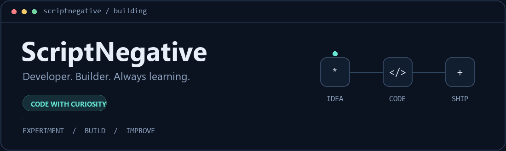

  

### Hey, I'm ScriptNegative 👋

I've spent **7 years in technology**, building with **Python and other programming languages**. I currently run **VDNX** and have worked on **many blockchain projects**.

These days, I'm especially interested in **AI, automation, and developer tools** — and how they can help people build better software.

 

### What I'm building

**[RelayCrew](https://github.com/ScriptNegative/relaycrew)**  
A lightweight skill for coordinating AI coding agents: focused tasks, clear file ownership, and useful handoffs. Built for Agent Skills-compatible tools, including Codex and Claude Code.

[Explore the project →](https://github.com/ScriptNegative/relaycrew#readme) · [Latest release](https://github.com/ScriptNegative/relaycrew/releases/latest)

 

### A few things about me

- I like lightweight solutions, clear interfaces, and tools that solve real problems.
- I'm exploring practical ways to bring AI into everyday development.
- I build, test, learn from the result, and keep improving.

 

**Curious about the same things?** Take a look around my repositories. Ideas, useful feedback, and contributions are welcome.

---

Stay curious. Build something useful.

